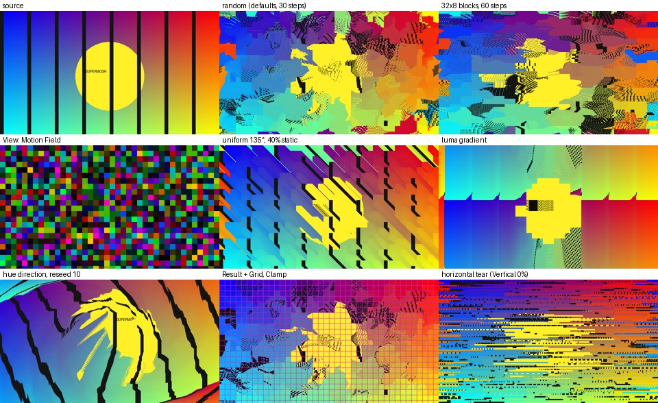

# Supermosh Glide for EffectCraft

An [EffectCraft](https://github.com/storytold/effectcraft) effect plug-in that brings the
**glide** datamosh of [Supermosh](https://github.com/supermosh/supermosh.github.io) (by
[Nino Filiu](https://ninofiliu.com)) into your compositions. Every parameter of Supermosh's glide
engine is exposed, plus extra controls for timing, motion fields, edges and output.



* WebAssembly plug-in, [plug-in API v1](https://github.com/storytold/effectcraft/blob/main/docs/plugins.md)
* Sandboxed (no imports), deterministic, multithread-safe
* Keyframable like any built-in effect: every parameter is an ordinary property
* Tested in EffectCraft 0.19.0 (desktop CLI renders)

## What it does

Supermosh's original engine (2021, `core/src/index.ts`) cuts the frame into blocks, gives each
block a small shift, and then, frame after frame, redraws the picture with every block copied
from its shifted position, **feeding each result back in**. Moving blocks drag their pixels
along and the image smears and melts: the "glide".

This plug-in reproduces that loop exactly. An EffectCraft plug-in can't remember earlier frames,
so after `n` steps it works out directly where each output pixel came from (the motion maps of
all `n` steps composed, by repeated squaring) and samples the incoming frame once. Long glides
stay fast and scrubbing gives the same result as playing.

> **Freeze the layer for a classic Supermosh glide.** The effect glides the frame it receives.
> Supermosh glided one frozen frame. To match it, freeze a video layer at the glide start (Layer ▸
> Time ▸ Freeze Frame) and set **Glide Start** to that time. On a playing layer the glide applies
> to each new frame, giving a live, moving smear instead.

> **Still images (and solids, text, shapes): drive Steps with an expression.** EffectCraft caches
> layers whose pixels don't change and only re-renders an effect over time when it is on
> EffectCraft's own list of time-dependent effects. Plug-ins can't join that list yet, so in
> **Time** mode a still image keeps showing its first rendered frame. Set **Steps From** to
> **Steps Slider** and add an expression to **Steps** instead:
>
> ```js
> Math.max(0, (time - 2) * 30)   // glide from 2 s at 30 steps per second
> ```
>
> Video layers, including freeze-framed ones, work in Time mode as described.

Supermosh's current version datamoshes the compressed video (it drops keyframes and splices
P-frames). A plug-in only receives decoded pixels, so that technique is out of scope here.

## Install

1. Download `dist/supermosh_glide.wasm` from this repository, or [build it](#build).
2. In EffectCraft (desktop or CLI), choose **Effect ▸ Load Effect Plug-in…** and pick the file,
   or copy it into the `Plug-ins` folder next to EffectCraft's settings to load it at start-up:
   * macOS: `~/Library/Application Support/EffectCraft/Plug-ins`
   * Windows: `%APPDATA%\EffectCraft\Plug-ins`
   * Linux: `~/.config/effectcraft/Plug-ins`
3. Apply **Stylize ▸ Supermosh Glide** to a layer.

Headless:

```sh
effectcraft-cli exec effect.plugins.load '{"path": "dist/supermosh_glide.wasm"}'
```

The effect id is `io.github.bits-by-brandon.supermosh-glide`. WebAssembly plug-ins run in
EffectCraft's desktop app and CLI, not in its web build.

## Parameters

Defaults equal Supermosh's `config`: 30 steps per second (`fps`), 16 px blocks (`size`), and the
shift list `0, 1, -1, 2, -2, 4, -4, 8, -8` (`xyShifts`). Distances are in layer pixels. They are
scaled at preview resolutions, and any shift that moves at full size still moves at least
1 px in a preview.

### Timing

| Parameter | Default | |
|---|---|---|
| **Steps From** | Time | **Time**: the glide advances with layer time (Supermosh's glide segment). **Steps Slider**: the **Steps** parameter sets the step count directly, so you can keyframe it to ramp, pause or reverse the glide. |
| **Glide Start (s)** | 0 | Layer time when the glide begins (Supermosh's segment `time`). Before it, the layer is untouched. |
| **Glide Length (s, 0 = endless)** | 0 | How long it glides (Supermosh's segment `length`). |
| **After Glide** | Hold Last Step | What happens after **Glide Length**: hold the last step, or show the source again. |
| **Steps per Second** | 30 | Glide steps per second of layer time (Supermosh's `fps`: one step per frame). |
| **Steps** | 0 | The step count when **Steps From** is Steps Slider. Fractions are used when **Blend Between Steps** is on. |
| **Blend Between Steps** | off | Cross-fade between whole steps for smooth slow motion, rather than snapping. |
| **Max Steps** | 1000 | Safety cap on the step count. |

### Blocks (Supermosh's `size`)

| Parameter | Default | |
|---|---|---|
| **Block Width** / **Block Height** | 16 / 16 | Block size in pixels (Supermosh uses square blocks). |
| **Grid Origin** | top-left | Where the block grid starts. Animate it to slide the grid. |

### Shift list (Supermosh's `xyShifts`)

| Parameter | Default | |
|---|---|---|
| **Shift List Length** | 9 | How many of the 16 shift slots are used. |
| **Shift 1 … Shift 16** | 0, 1, −1, 2, −2, 4, −4, 8, −8, 16, −16, 32, −32, 3, −3, 6 | The shift values in pixels. In Random mode each block picks its x shift and its y shift from this list. |
| **Horizontal Amount (%)** / **Vertical Amount (%)** | 100 / 100 | Scale every shift's x or y part. 0 locks an axis; negative values reverse it. |

### Motion field

| Parameter | Default | |
|---|---|---|
| **Motion Source** | Random (Shift List) | **Random**: each block picks shifts from the list, as Supermosh's glide does. **Luma Gradient**: blocks flow along the brightness gradient, toward brighter areas. **Hue Direction**: each block's hue sets its direction (red = up, then clockwise around the colour wheel) and its saturation sets its speed. **Uniform Direction**: every block moves the same way. |
| **Random Seed** | 0 | Picks a different random field. |
| **Reseed Every N Steps (0 = never)** | 0 | Pick a new field every N steps, so the motion keeps changing, like Supermosh's movement segments. Each new field costs a pass over the frame, so small values over long glides are slow; see [Performance](#performance). |
| **Direction** | 0° | **Uniform**: the direction content moves (0° = up, clockwise). **Luma Gradient** and **Hue Direction**: rotates the motion. |
| **Distance (px)** | 4 | Speed per step for Luma Gradient, Hue Direction and Uniform. Negative values reverse the motion. |
| **Snap to Shift List** | off | Round the non-random modes' shifts to the nearest shift-list value, for blockier motion. |
| **Random Jitter (%)** | 0 | Share of blocks that take a random shift from the list instead. |
| **Static Blocks (%)** | 0 | Share of blocks that don't move. |

### Output

| Parameter | Default | |
|---|---|---|
| **Edges** | Wrap | Where pixels come from past the frame's edge: **Wrap** (Supermosh), **Clamp**, **Mirror** or **Transparent**. |
| **Force Opaque** | off | Make the result fully opaque, as Supermosh's output is. |
| **Mix (%)** | 100 | Blend with the unprocessed frame. |
| **View** | Result | **Motion Field** shows each block's motion: hue is direction, brightness is speed. **Result + Grid** draws the block grid over the result. |
| **Grid Color** | magenta | Colour and opacity of the grid lines. |

## Recipes

* **Classic Supermosh glide:** on a video layer, go to 2 s and choose Layer ▸ Time ▸ Freeze Frame. Then set Glide Start to 2 and Glide Length to 3. Keep the other defaults.
* **Melting drift:** set Motion Source to Uniform Direction, Direction to 180°, Distance to 2, Static Blocks to 40%, and Blend Between Steps on.
* **Colour-driven swirl:** set Motion Source to Hue Direction, Distance to 6, and Reseed Every N Steps to 15.
* **Datamosh hit on the beat:** set Steps From to Steps Slider and keyframe Steps from 0 to 40 over 10 frames, then hold.
* **Horizontal tearing:** set Vertical Amount to 0, Block Height to 4 and Block Width to 64.

## Performance

EffectCraft runs WebAssembly plug-ins in an interpreter with a fixed budget of work per pixel. A
frame that overruns it is left unprocessed. The plug-in plans each frame against that budget:

* **Without reseeding**, glide length is almost free: steps are combined by repeated squaring, so
  1,000 steps cost about as much as 30. A 1080p frame takes roughly 1 s in EffectCraft's
  interpreter whatever the step count.
* **With Reseed Every N Steps**, each new field costs one pass over the frame. If a frame can't
  afford all its steps, the glide stops advancing at the last step it can afford (as with Max
  Steps) rather than failing. With 16 px blocks that is about 600 reseeded steps per frame at any
  resolution, fewer with very small blocks.
* **Very small blocks** (under 6 px) are processed pixel by pixel and cost several times more.

`tools/fuel-probe` runs the plug-in in the same interpreter and fuel metering as EffectCraft and
reports what a frame costs:

```sh
cargo build --release --target wasm32-unknown-unknown
cd tools/fuel-probe
cargo run --release -- ../../target/wasm32-unknown-unknown/release/supermosh_glide.wasm 1920 1080 step_source=1 steps=300 reseed=1
```

## Build

Requires Rust 1.85 or later (edition 2024) and the `wasm32-unknown-unknown` target.

```sh
rustup target add wasm32-unknown-unknown
cargo build --release --target wasm32-unknown-unknown
# → target/wasm32-unknown-unknown/release/supermosh_glide.wasm
cargo test   # native tests, including checks against Supermosh's literal per-frame loop
```

## Licence and credits

Supermosh is © Nino Filiu and licensed under the GNU GPL v3. This plug-in ports its glide
algorithm, so it is licensed under the **GNU General Public License v3.0 or later** as well
(see [LICENSE](LICENSE)). It isn't affiliated with or endorsed by Supermosh or EffectCraft.
Ported from Supermosh at commit
[`4705031`](https://github.com/supermosh/supermosh.github.io/blob/4705031e636254e079b096e23f7ae1418f1ae73a/core/src/index.ts).
